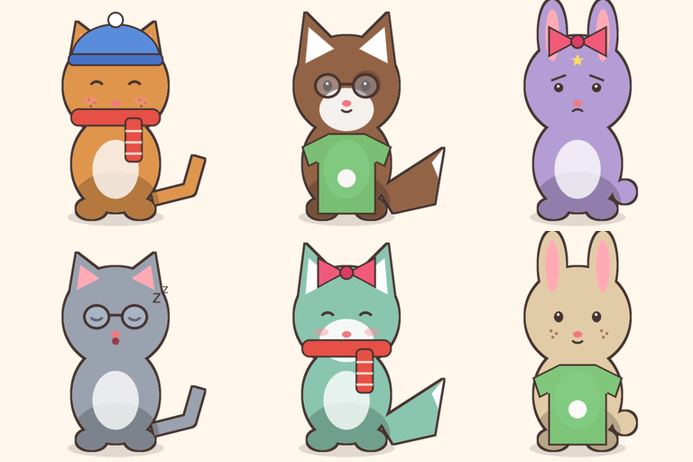

# Питомец — Finch внутри Telegram

Бот, в котором живёт твой питомец. Он растёт, когда ты заботишься о себе:
💧 вода, 🏃 движение, 📖 чтение, 😴 сон. Если забросить дела, он грустит,
но никогда не умирает и не стыдит.

Это каркас **недели 1** из концепции: бот, питомец из слоёв, 4 кнопки дел,
гардероб и мягкое напоминание раз в день. Метрики для решения «развиваем или
меняем ядро» пишутся с первого дня.



> Графика в `assets/` — **временные заглушки**, нарисованные кодом. Они
> показывают, какие файлы нужны и как они складываются. Настоящий арт кладётся
> поверх с теми же именами, без изменений в коде.

## Быстрый старт

```bash
cp .env.example .env          # вписать BOT_TOKEN от @BotFather и свой id в ADMIN_IDS
docker compose up -d --build  # PostgreSQL + бот
```

Без Docker:

```bash
python -m venv .venv && . .venv/bin/activate
pip install -r requirements-dev.txt
# поднять PostgreSQL и указать DATABASE_URL в .env
python -m bot
```

Таблицы создаются автоматически при старте (`bot/schema.sql`).

## Что умеет

| Команда / кнопка | Что делает |
|---|---|
| `/start` | Выбор вида → цвета → имени. `start=ref_ID` запоминает, кто пригласил |
| `/pet` | Карточка: картинка, настроение, 4 шкалы, кнопки дел |
| 💧 🏃 📖 😴 | Пополняют шкалу; у каждого дела дневной лимит (вода 8, движение 3, чтение 3, сон 1) |
| 👕 Гардероб, `/wardrobe` | Надеть или снять вещь; в одном слоте может быть одна вещь. На старте дарятся 3 вещи |
| `/reminder` | `off`, `on`, `20` — напоминать в 20:00 по местному времени |
| `/timezone` | Часовой пояс: 11 зон России, от Калининграда до Камчатки |
| `/privacy` | Какие данные хранит бот и зачем |
| `/delete_me` | Удалить питомца и все данные пользователя (с подтверждением) |
| `/stats` | Метрики, только для `ADMIN_IDS` |

**Как живёт питомец** (`bot/pet.py`): шкалы убывают на 2 в час (со 100 до 0 примерно
за двое суток). Пересчёт ленивый, при чтении, поэтому крон не нужен. Настроение
(`happy`/`ok`/`sad`/`sleepy`) считается из среднего по шкалам и меняет
выражение мордочки.

**Напоминание** (`bot/reminders.py`) приходит раз в день в выбранный час по местному времени, только
если сегодня ещё не было ни одного дела и питомец заведён не сегодня. Если
пользователь заблокировал бота, это отмечается, и ему больше не пишем.

## Запуск в России

Бот рассчитан на русскоязычных пользователей. Ниже то, что для этого уже сделано
в коде, и то, что нужно сделать при запуске. Это памятка, а не юридическая
консультация: перед публичным запуском сверьтесь с актуальными требованиями.

### Уже в коде

- **Часовые пояса.** По умолчанию Москва, команда `/timezone` даёт выбрать любую
  из 11 зон России. Напоминание приходит в выбранный час по местному времени,
  дневные лимиты дел сбрасываются в местную полночь.
- **Минимум персональных данных.** Бот хранит только Telegram ID, без имени,
  username и телефона. Питомец, журнал дел и настройки привязаны к этому ID.
- **`/privacy`**: что хранится, зачем и как удалить. В приветствии есть строка
  о согласии со ссылкой на `/privacy`. Контакт для вопросов задаётся в `PRIVACY_CONTACT`.
- **`/delete_me`**: полное удаление данных пользователя по его запросу.
- **Если сервер не видит Telegram или Docker Hub:** `TELEGRAM_PROXY` (socks5 или http),
  `TELEGRAM_API_URL` (свой Local Bot API Server), `DOCKER_REGISTRY` и `PIP_INDEX_URL`
  (зеркала). Все настройки описаны в `.env.example`. По умолчанию прокси и зеркала
  не используются.

### Что сделать при запуске

1. **Сервер с базой данных — в России.** По 152-ФЗ (ст. 18, ч. 5) персональные
   данные граждан РФ должны храниться в базах на территории России. Telegram ID
   вместе с журналом дел — это персональные данные. Проще всего держать бота и
   PostgreSQL на одном российском VPS: Timeweb Cloud, Selectel, Yandex Cloud,
   VK Cloud, Beget и т. п. Хватит 1 ГБ памяти.
2. **Уведомление Роскомнадзора** об обработке персональных данных подаётся до начала
   обработки, онлайн на pd.rkn.gov.ru. Подаёт оператор, то есть тот, кто запускает
   бота. Для публичного запуска и будущих платежей удобнее оформить ИП или ООО.
3. **Полная политика обработки ПДн.** `/privacy` — краткая версия. Полный документ
   нужно опубликовать (например, страницей на telegra.ph) и указать ссылку в
   описании бота у @BotFather.
4. **Подростки.** Аудитория Telegram-ботов с питомцами молодая. До недели 4 (покупки)
   решите, как быть с покупками несовершеннолетних, и пропишите это в `/terms`.
5. **Оплата (неделя 4).** Купить Stars из России через App Store и Google Play сложно,
   а вывод идёт через Fragment в TON. Telegram требует Stars для цифровых товаров
   внутри ботов. Российские провайдеры (ЮKassa и др.) подключаются через
   Telegram Payments, но применимость к цифровым товарам нужно проверить по
   актуальным правилам Telegram. Проверить до того, как строить магазин.

## Графика: как устроены слои

Это главное узкое место проекта, поэтому система рассчитана на художника.

Холст 512×512, порядок снизу вверх:

```
фон → species/<вид>/body.png (окрашивается) → species/<вид>/extras.png
    → traits/<черта> → species/<вид>/lines.png → expressions/<настроение> → items/<вещь> (по slot_order)
```

- **body.png** рисуется в оттенках серого. Рендерер умножает его на цвет из
  `manifest.json`, поэтому 6 цветов не требуют 6 картинок. Тени — более тёмный серый.
- **extras.png** — то, что не перекрашивается: животик, внутренние уши, нос.
- **lines.png** — контур.
- **Вещи, черты, выражения** ищутся так:
  1. `items/<вещь>/<вид>.png` — нарисовано под конкретный вид, полный холст 512×512;
  2. иначе `items/<вещь>/default.png` — небольшая картинка, которая центрируется
     в **якоре** своего слота (`anchors` у вида в `manifest.json`).

  Вещь рисуется один раз. Если на каком-то виде она села криво, для него
  дорисовывается отдельный файл.
- Новая вещь = папка с картинкой + строка в `manifest.json` (`name`, `slot`).
- **После любой замены арта поднимите `version` в `manifest.json`**, иначе бот
  будет показывать старые картинки из кэша.

Перегенерировать заглушки: `python tools/make_placeholder_art.py`.

Кэш двухуровневый: готовые PNG лежат в `cache/`, а `file_id` уже загруженной
в Telegram картинки хранится в таблице `render_cache`. Каждая комбинация
загружается один раз. Тот же `file_id` понадобится для инлайн-режима на неделе 2.

## Метрики

Критерий успеха из концепции считается командой `/stats`:

- **D7 сами, без напоминания** — доля тех, у кого 7-й день с момента заведения
  питомца уже закончился и кто в этот день отметил хотя бы одно дело *сам*.
  «Не сам» значит, что нажата кнопка под напоминанием или дело отмечено
  в течение 3 часов после него (`care_log.after_reminder`).
- **Отправили другу** — пока считается по приглашениям (`users.referred_by`).
  Точная цифра появится на неделе 2 вместе с inline feedback.

Сырые данные лежат в таблицах `care_log` и `events` (`start`, `pet_created`,
`reminder_sent`).

## Тесты

```bash
pip install -r requirements-dev.txt
pytest                                                    # логика и рендер
TEST_DATABASE_URL=postgresql://user@localhost/pet_test pytest  # + БД (таблицы в ней удаляются!)
```

`tests/test_render.py` собирает **каждую** вещь, черту и выражение на **каждом**
виде. Если художник забудет файл, тест это поймает.

## Структура

```
bot/
  __main__.py      запуск, polling, цикл напоминаний
  config.py        переменные окружения / .env
  db.py, schema.sql
  pet.py           шкалы, дела, настроение (чистые функции)
  render.py        склейка слоёв Pillow + кэш
  views.py         карточка питомца, загрузка картинок с кэшем file_id
  keyboards.py     кнопки и callback data
  texts.py         все тексты (питомец говорит мягко, без чувства вины)
  reminders.py
  regions.py       часовые пояса России
  handlers/        onboarding (/start), care (дела, гардероб),
                   settings (/reminder, /timezone, /privacy, /delete_me, /help, /stats)
assets/            manifest.json + слои
tools/             генератор заглушек
tests/
```

## Дальше по плану

- **Неделя 2:** инлайн-режим (`@бот` → питомец в любой чат с кнопкой «завести своего»
  `t.me/<бот>?start=ref_<id>`), включить inline feedback в BotFather и писать
  `chosen_inline_result` в `events`.
- **Неделя 3:** запуск на 50–100 человек.
- **Неделя 4:** магазин за Stars (валюта `XTR`), `/paysupport`, `/terms`, возвраты.
  Поле `owned_items.source` уже предусмотрено.

Известные упрощения первой версии: состояние онбординга хранится в памяти (после
перезапуска бот попросит нажать /start заново).
